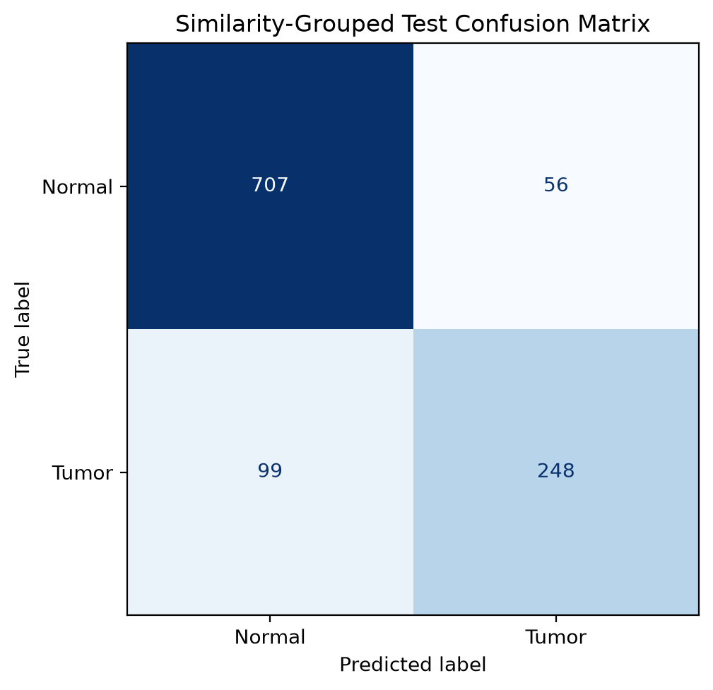
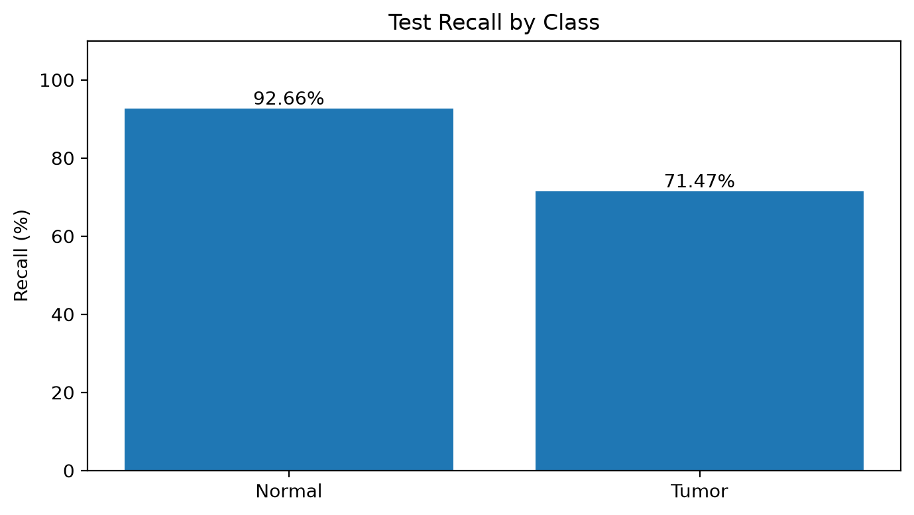
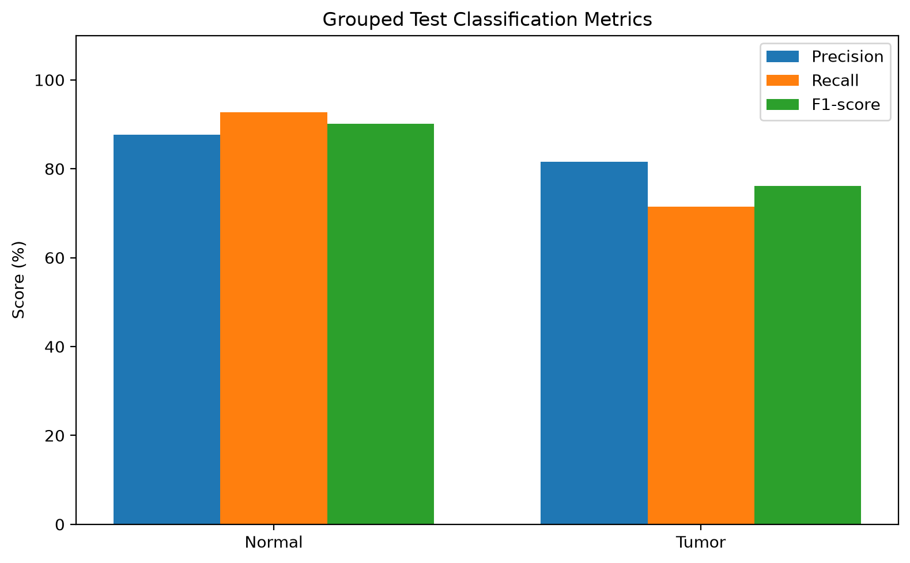

## Fuzzy-Enhanced Kidney Tumor Detection Using Twin Transfer Learning and a Weighted Ensemble Classifier.

An academic research prototype for classifying kidney CT images as **Normal** or **Tumor** using image enhancement, pretrained deep learning feature extractors, and a weighted machine learning ensemble.

## Project Overview

This project implements an end-to-end kidney CT image classification pipeline with an interactive Streamlit dashboard.

The system combines:

- Fuzzy-style grayscale image enhancement
- DenseNet121 feature extraction
- ResNet101 feature extraction
- Deep feature fusion
- Support Vector Machine (SVM) classification
- Random Forest classification
- Weighted ensemble prediction

**Important:** This is an experimental academic project, not a clinically validated medical diagnostic system.

## Technology Stack

- Python
- PyTorch and Torchvision
- Scikit-learn
- NumPy
- Pillow
- Streamlit
- Matplotlib
- Joblib

## Model Architecture

1. Upload a kidney CT image.
2. Apply fuzzy-style image enhancement.
3. Extract 1,024 features using pretrained DenseNet121.
4. Extract 2,048 features using pretrained ResNet101.
5. Concatenate both feature vectors into 3,072 features.
6. Apply trained SVM and Random Forest classifiers.
7. Combine their scores using a weighted ensemble.
8. Display the predicted class in the Streamlit dashboard.

The feature extractors use pretrained ImageNet weights. The current implementation does not fine-tune these neural networks on the kidney CT dataset.

## Dataset

Dataset: CT Kidney Dataset - Normal, Cyst, Tumor and Stone

Source: https://www.kaggle.com/datasets/nazmul0087/ct-kidney-dataset-normal-cyst-tumor-and-stone

This project uses two classes:

- Normal: 5,077 images
- Tumor: 2,283 images
- Total: 7,360 images

The dataset is not included in this repository.

## Evaluation Methodology

An initial image-level split produced unusually high accuracy. Further investigation identified substantial visual similarity between images across the training and test partitions.

To reduce this potential source of leakage, the project uses a similarity-grouped split based on perceptual hashing.

Approximate split sizes:

| Partition | Images |
|---|---:|
| Training | 5,142 |
| Validation | 1,108 |
| Testing | 1,110 |

Perceptual-hash grouping is a heuristic. It does not establish that the splits are independent at the patient or CT-study level.

## Test Results

The saved similarity-grouped evaluation reports:

| Metric | Result |
|---|---:|
| Test accuracy | 86.04% |
| Normal recall | 92.66% |
| Tumor recall | 71.47% |
| Tumor precision | 81.58% |
| Tumor F1-score | 76.19% |
| Test images | 1,110 |

### Confusion Matrix

| Actual / Predicted | Normal | Tumor |
|---|---:|---:|
| Normal | 707 | 56 |
| Tumor | 99 | 248 |

The model correctly classified 955 of 1,110 test images.

The ensemble uses:

- SVM weight: 0.75
- Random Forest weight: 0.25
- Classification threshold: 0.30

These settings were selected using validation results.

### Evaluation Visualizations







## Running the Project

Create a Python virtual environment and install the dependencies:

```bash
python -m venv .venv
source .venv/bin/activate
pip install -r requirements.txt


```

Start the Streamlit dashboard:

```bash
streamlit run app.py
```

**Note:** Trained model files are excluded from GitHub. Predictions require the locally trained models in `models_grouped/`.

## Project Files

- `app.py` — Streamlit dashboard
- `preprocessing.py` — CT image preprocessing
- `feature_extraction.py` — DenseNet121 and ResNet101 feature extraction
- `prediction_grouped.py` — Ensemble prediction
- `train_grouped_classifiers.py` — Classifier training
- `evaluation_grouped.py` — Model evaluation

## Limitations

- The similarity-grouped split does not guarantee patient-independent evaluation.
- Tumor recall was 71.47% on the held-out test set.
- The system has not undergone external clinical validation.
- This project is intended for academic research only, not medical diagnosis.

## Author

**Niharika Kadam**

GitHub: https://github.com/NIHARIKAKADAM
